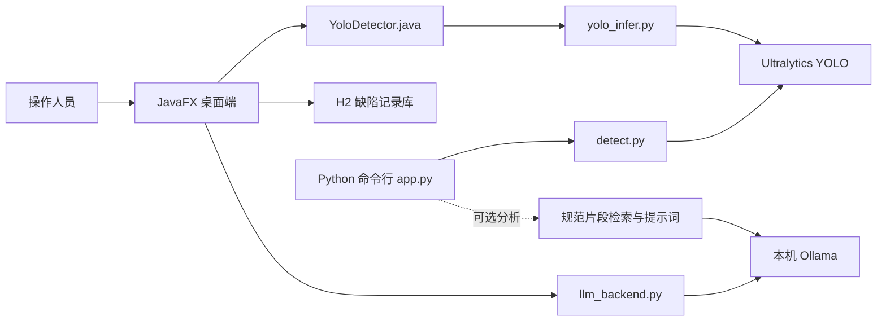

# 基于 YOLO 的桥梁缺陷智能检测系统

这是一个面向课程项目的桥梁混凝土表观缺陷检测与管理原型。系统以 YOLO 目标检测为核心，提供 JavaFX 桌面界面、Python 命令行检测入口、检测记录管理，以及可选的 Ollama 大模型辅助分析。

> **项目范围：** 当前代码和类别面向梁式桥混凝土表观缺陷。仓库中没有隧道数据集或隧道缺陷类别，因此现阶段不应称为已经实现的“桥隧一体化检测系统”。

## 功能概览

- 对桥梁图片执行 YOLO 目标检测，输出缺陷类别、置信度和边界框。
- 在 JavaFX 桌面端查看检测结果、管理缺陷记录，并通过 H2 嵌入式数据库保存数据。
- 提供 HTTP/MJPEG 网络摄像头界面。
- 可连接本机 Ollama，为图片或检测结果提供辅助问答与文字分析。
- 提供独立的 Python 命令行流程；命令行流程可选拼接桥梁规范片段，再请求 Ollama 生成分析。

大模型生成内容属于辅助信息，不能替代有资质人员的现场检查、测量和规范判定。

## 系统结构



桌面端与命令行端是两条独立实现路径：桌面端由 Java 调用 Python 推理脚本；命令行端由 app.py 调用 detect.py。两者的默认权重路径和部分分析流程不同。

## 检测类别

| ID | 类别 | 英文名 |
|---:|---|---|
| 0 | 裂缝 | Crack |
| 1 | 破损 | Breakage |
| 2 | 蜂窝 | Comb |
| 3 | 孔洞 | Hole |
| 4 | 钢筋外露 | Reinforcement |
| 5 | 渗水 | Seepage |

类别名称来自项目检测代码。数据目录中的 README 统计与当前本机数据目录并不完全一致；在数据划分和标签核验前，不把其中的数量当作已确认数据集统计。

## 目录导航

| 文件或目录 | 内容 |
|---|---|
| [项目介绍](项目介绍.md) | 项目目标、技术路线、系统边界和当前限制 |
| [使用说明](使用说明.md) | 环境准备、桌面端和命令行端启动方法、常见问题 |
| 源码/ | JavaFX 界面、Python 推理与大模型调用代码 |
| 源码/detect.py | Python YOLO 检测器 |
| 源码/app.py | Python 命令行流程入口 |
| 源码/requirements.txt | Python 依赖版本清单 |
| 源码/data/README.md | 数据集说明草稿；统计和本地路径需复核 |

## 快速开始

### JavaFX 桌面端

准备好 JDK、JavaFX SDK、Python 依赖和桌面端默认权重后，在 Windows 下运行：

```powershell
.\源码\run.bat
```

启动细节和依赖版本见[使用说明](使用说明.md)。该脚本会在源码目录内编译 Java 文件，然后启动 JavaFX 程序。

### Python 命令行

在 Windows PowerShell 中进入源码目录，执行仅检测示例：

```powershell
cd .\源码
python app.py --image "D:\path\to\bridge.jpg" --no-llm
```

如默认权重不存在，可通过 --model-path 指定权重。启用大模型分析时，需要本机 Ollama 服务和配置的模型。

## 权重与数据说明

- JavaFX 桌面端默认读取 源码/app/src/best.pt。
- Python 命令行端默认查找 源码/models/best.pt，也会查找代码中列出的其他候选路径。
- 这两个默认权重不是同一个文件；如需统一对比或复现实验，应显式指定并记录权重文件。
- YOLO 推理代码和配置并不等于完整训练数据。原始图片、标签、数据划分、训练配置及权重的授权与可复现性需要单独核实。
- 本项目没有在此 README 中公布精度数字：现有报告、训练记录和权重尚未形成可追溯到同一模型、数据划分和评测脚本的完整证据链。

## 上传前请检查

1. 检查数据集、图片、模型权重、第三方代码和模型的许可与再分发条件。
2. 当前项目根目录没有统一的 LICENSE 文件；公开代码前需明确项目许可，并分别核对第三方组件、数据和模型的许可。
3. 确认仓库中没有个人数据、聊天记录、数据库文件、API 密钥或本机配置。
4. 若发布评测结果，请同时说明权重文件、数据划分、评测命令和指标口径。
5. 后续增加数据、模型或运行结果时，先检查 .gitignore 与待提交文件清单。
